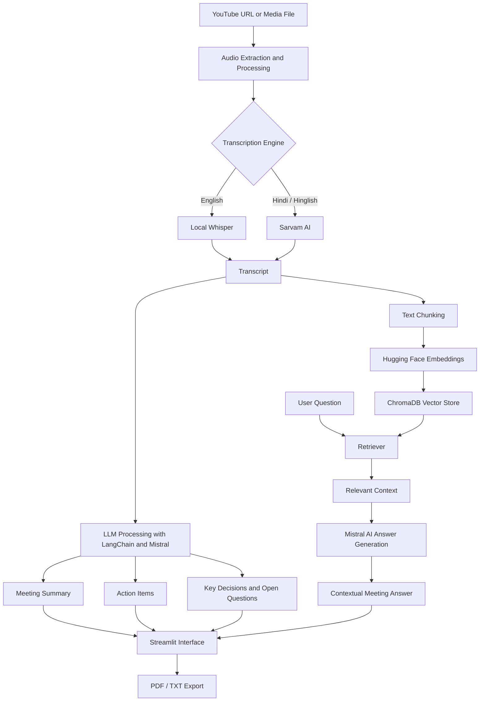

# 🎙️ AI Meeting Assistant — Powered by Generative AI & RAG

An AI-powered meeting assistant that transforms audio and video recordings into structured, searchable meeting insights. Transcribe conversations, generate concise summaries, extract action items and key decisions, and chat with your meeting using **Retrieval-Augmented Generation (RAG)**.

Built with Python, Whisper, Sarvam AI, LangChain, Mistral AI, ChromaDB, Hugging Face Embeddings, and Streamlit.

---

## ✨ Features

- 🎧 **Audio & Video Input:** Process audio/video files and supported YouTube URLs.
- 🗣️ **Multilingual Transcription:** Use local OpenAI Whisper for English transcription and Sarvam AI for Hindi/Hinglish transcription.
- 📝 **AI-Powered Summarization:** Generate concise, structured meeting summaries using an LLM.
- ✅ **Action Item Extraction:** Identify tasks, assigned owners, and deadlines when available in the conversation.
- 🎯 **Decision Extraction:** Automatically identify important decisions made during meetings.
- ❓ **Open Questions & Follow-ups:** Highlight unresolved questions and pending discussion points.
- 💬 **Chat with Your Meeting:** Ask questions about the transcript and receive context-aware answers using RAG.
- 🔎 **Semantic Search:** Retrieve relevant transcript chunks using embeddings and ChromaDB.
- 📄 **Report Export:** Export meeting insights as PDF or TXT.
- 🖥️ **Interactive UI:** Use a Streamlit interface to interact with the application.

## 🛠️ Tech Stack

| Technology | Purpose |
|---|---|
| Python | Core application logic |
| OpenAI Whisper | Local speech-to-text transcription |
| Sarvam AI | Hindi/Hinglish transcription |
| LangChain (LCEL) | LLM pipeline orchestration |
| Mistral AI | Summarization, extraction, and answer generation |
| Hugging Face Embeddings | Convert transcript chunks into vectors |
| ChromaDB | Store and retrieve vector embeddings |
| Streamlit | Interactive web interface |
| FFmpeg | Audio/video processing, if used by the implementation |

## 🏗️ System Architecture



## 🔄 How It Works

1. **Input:** The user provides a supported YouTube URL or uploads an audio/video file.
2. **Audio Processing:** The application extracts and prepares audio for transcription.
3. **Transcription:** The selected speech-to-text engine generates the meeting transcript.
4. **Meeting Analysis:** LangChain orchestrates LLM calls to summarize the transcript and extract action items, decisions, and open questions.
5. **Chunking & Embeddings:** The transcript is divided into smaller chunks and converted into vector embeddings.
6. **Vector Storage:** ChromaDB stores the embeddings for semantic retrieval.
7. **RAG-Based Chat:** A user's question retrieves relevant transcript chunks, which are supplied to the LLM to generate a context-aware answer.
8. **Results & Export:** The Streamlit interface displays the generated insights and supports report export.

## 📂 Project Structure

```text
AI-Meeting-Assistant/
├── utils/
│   └── audio_processor.py
├── transcriber.py
├── translator.py
├── summarise.py
├── extractor.py
├── vector_store.py
├── rag_engine.py
├── main.py
├── requirements.txt
├── .env.example
├── .gitignore
└── README.md
```

*The structure above is illustrative. Update it to match your actual repository files and folders.*

## 🚀 Getting Started

### Prerequisites

- Python 3.10 or a compatible version supported by your dependencies
- Git
- FFmpeg, if required by your audio-processing implementation
- A Mistral AI API key
- A Sarvam AI API key for the relevant transcription functionality

### 1. Clone the repository

```bash
git clone https://github.com/Kishansavani-Git/AI-Meeting-Assistant.git
cd AI-Meeting-Assistant
```

### 2. Create a virtual environment

**Windows**

```bash
python -m venv .venv
.venv\Scripts\activate
```

**Linux / macOS**

```bash
python3 -m venv .venv
source .venv/bin/activate
```

### 3. Install dependencies

```bash
pip install -r requirements.txt
```

### 4. Configure environment variables

Create a `.env` file in the project root and add the API keys expected by your application.

```env
MISTRAL_API_KEY=your_mistral_api_key
SARVAM_API_KEY=your_sarvam_api_key
```

Use the exact variable names expected by your code. Keep the `.env` file private and never commit real API keys to GitHub.

### 5. Run the application

If `main.py` launches the Streamlit interface, run:

```bash
streamlit run main.py
```

Otherwise, use the entry point defined in your implementation.

Open the local URL displayed by Streamlit in your browser.

## 🔑 API Setup

- **Mistral AI:** https://console.mistral.ai/
- **Sarvam AI:** https://dashboard.sarvam.ai/

Check the providers' current pricing, free-tier limits, and API documentation before use. API access may require an account and can be subject to usage limits.

## 💡 Example Use Cases

- Generate meeting minutes from recorded discussions.
- Extract tasks and follow-ups from team meetings.
- Review decisions made during project planning.
- Search long recordings without replaying the entire meeting.
- Ask questions such as:
  - What were the main topics discussed?
  - Which action items were assigned?
  - What decisions were made?
  - Which questions remain unresolved?
  - What was discussed about a particular topic?

## 🧪 Testing & Evaluation

Test the application with representative recordings and document the results.

| Test Case | Expected Outcome |
|---|---|
| English audio input | Transcript generated using the configured Whisper pipeline |
| Hindi/Hinglish audio input | Transcription through the configured Sarvam AI integration |
| Meeting summarization | Structured summary generated |
| Action-item extraction | Tasks, owners, and deadlines identified when available |
| Meeting Q&A | Answers generated using retrieved transcript context |
| Report export | Meeting report exported in the supported format |

Record actual results and known limitations before presenting this table as completed testing.

## 🔒 Privacy & Security

- Keep API keys in environment variables rather than source code.
- Exclude `.env`, virtual environments, temporary media, and sensitive recordings from version control.
- Local Whisper transcription can reduce the need to send audio to a transcription API, depending on the configured pipeline.
- External APIs may receive the text or audio sent to them. Review provider privacy policies before processing confidential meetings.

## ⚠️ Limitations

- Transcription accuracy depends on audio quality, accents, background noise, and overlapping speakers.
- Extracted action items and decisions may require manual verification.
- RAG answers depend on transcript quality and the relevance of retrieved chunks.
- API-based functionality depends on network access, provider availability, and usage limits.
- YouTube processing depends on supported URLs and applicable access restrictions.

## 🔮 Future Improvements

- Speaker diarization and speaker-wise summaries.
- Timestamps and source references for generated answers.
- Improved retrieval through hybrid search and reranking.
- Meeting history and persistent session management.
- Support for additional languages and transcription engines.
- Authentication and secure deployment.
- Evaluation using transcription error rates, retrieval relevance, and summary quality metrics.

## 📚 References

- [OpenAI Whisper](https://github.com/openai/whisper)
- [LangChain Documentation](https://python.langchain.com/docs/)
- [Mistral AI Documentation](https://docs.mistral.ai/)
- [Sarvam AI Documentation](https://docs.sarvam.ai/)
- [ChromaDB Documentation](https://docs.trychroma.com/)
- [Hugging Face Documentation](https://huggingface.co/docs)
- [Streamlit Documentation](https://docs.streamlit.io/)

## 👨‍💻 Author

**Kishan Savani**

- GitHub: [Kishansavani-Git](https://github.com/Kishansavani-Git)
- LinkedIn: [Kishan Savani](https://linkedin.com/in/KishanSavani)

---

*Built to make meeting information easier to understand, search, and act upon using Generative AI and Retrieval-Augmented Generation.*
